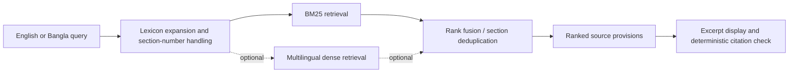

# Project Showcase Report

## Bangla-English Hybrid Retrieval and Citation-Verified QA for Bangladesh Criminal Procedure and Policing

**Project:** Bilingual Legal QA for Bangladesh Criminal Law and Law Enforcement  
**Status snapshot:** 27 November 2026  
**Type:** NLP research prototype and Streamlit demonstration

## Abstract

This project builds an NLP pipeline for searching Bangladesh criminal-law and policing provisions from English, Bangla, and colloquial legal questions. It combines a section-level legal corpus, Bangla-aware normalization and segmentation, a hand-built multilingual legal lexicon, BM25 retrieval, optional multilingual dense retrieval, and citation-checking/evaluation scaffolding. The current demo returns ranked original law excerpts rather than generated legal advice. It establishes the data and retrieval foundation for three research questions: comparative multilingual retrieval quality, the value of structured procedure facts, and the effect of citation verification.

The corpus currently contains 2,970 sections from 38 acts. Preprocessing produced 3,584 retrieval chunks. The BM25 app path is runnable with the saved token index; dense vectors and a FAISS index are also stored, but query-time dense search needs BGE-M3 model weights. The benchmark currently has 150 generated seed questions, all awaiting review. No final retrieval or generation results are claimed.

## 1. Problem and research questions

Citizens and junior officers may know the facts of an incident but not which Bangladesh legal provision to consult, particularly when asking in Bangla or colloquial language. This project studies retrieval quality and citation grounding for that use case.

- **RQ1:** Which retrieval setup performs best across formal English, formal Bangla, and colloquial Bangla legal questions: BM25, multilingual dense retrieval, or hybrid retrieval?
- **RQ2:** Does a structured procedure table improve answers to arrest, bail, and trial-court questions?
- **RQ3:** Does verifying citations against the corpus and retrieved context reduce unsupported section references?

## 2. Data

The project uses bdlaws as the canonical source, with BLAD and UKIL-DB-EN for fallback/enrichment. The included corpus is curated for criminal law, procedure, evidence, law enforcement, and related offences. It includes 38 acts and 2,970 section records.

| Coverage measure | Current value |
|---|---:|
| Included acts | 38 |
| Section records | 2,970 |
| Sections with English text | 1,892 |
| Sections with Bangla text | 1,078 |
| Fully bilingual acts | 0 |
| Retrieval chunks | 3,584 |

Section identity is maintained with `sec_uid` so any available English and Bangla versions can be linked. No machine translation is introduced. As a result, the corpus supports cross-language retrieval experiments, but does not offer aligned bilingual text for every act. The data collection report is `report/stage1_report.md`.

## 3. Preprocessing and NLP methods

The preprocessing pipeline cleans markup and presentation artifacts, applies NFC normalization and Bangla nukta recomposition, converts Bangla digits for retrieval text, and labels text using Bangla/Latin script ratios. It splits sentences and legal clauses while retaining subsection markers. Tokenization reports compare whitespace and embedding-model subword units.

For lexical retrieval, the pipeline builds a BM25-specific view with English/Bangla stopword removal and light stemming. Dense embedding text remains unfiltered. Sections are the primary retrieval unit; sections beyond the configured token budget are split into overlapping chunks that retain `sec_uid`.

The processed corpus contains 5,945 sentences, 11,571 clauses, and 3,584 chunks. The token statistics record 343,472 whitespace tokens and 574,762 subword tokens. These outputs and detailed justifications are in `report/stage2_report.md`.

The legal lexicon contains 80 concepts and 589 forms across English, Bangla, and colloquial usage. It supports query expansion for terms such as FIR, bail, cognizable offences, and related procedure vocabulary.

## 4. Retrieval architecture



Implemented retrieval includes a portable BM25 token index, a pure-Python BM25 fallback, legal dictionary expansion, exact section-number promotion, section-level deduplication, and an optional dense/reciprocal-rank-fusion path. Threat-related English and Bangla terms receive a targeted retrieval mapping to the relevant Penal Code sections; this rule was added after a query incorrectly retrieved an unrelated house-breaking passage.

Saved index artifacts are in `indexes/`: 3,584 chunk records, BM25 tokens, dense vectors, and a FAISS inner-product index. The Streamlit app intentionally runs BM25-only because the BGE-M3 weight files were removed to avoid multi-gigabyte downloads. The dense vectors cannot encode new queries by themselves; the model weights are required for dense query-time search.

## 5. Procedure lookup and citation checking

The CrPC Second Schedule has eight columns covering Penal Code section, offence, arrest without warrant, warrant/summons, bail, compoundability, punishment, and trial court. `src/procedure.py` currently produces an empty table because the section parser does not extract this schedule from the CrPC source.

`src/procedure_auto.py` downloads the official schedule PDF, attempts table extraction, preserves raw cells and page references, and overlays the Schedule II changes in the 2026 amendment. It marks all rows unverified and flags ambiguous grouped rows. The extractor has not yet been executed locally; therefore `data/clean/procedure.json` remains empty.

Citation verification checks that a cited act/section exists and that it appeared in the retrieved context. It does not perform semantic entailment checking. No automatic repair/retry loop or NLI evaluator is currently connected to the app.

## 6. Benchmark and evaluation

The project has a 150-item generated benchmark seed linked to Penal Code/CrPC sections and split into dev/test sets. All rows carry `needs_manual_review`; the Bangla question templates are not validated human-authored queries. The benchmark is not yet a gold-standard test set.

Evaluation code supports Recall@1/3/5, MRR, and nDCG@5 grouped by language style. No system scores have been produced. Before reporting results, the benchmark needs reviewed gold sections, additional punishment/procedure/bail/evidence/scenario and out-of-scope items, second-annotator labels, and an agreement calculation. The test split should remain untouched during system tuning.

## 7. Demonstration app

The Streamlit app is a modern search interface for entering English or Bangla questions and inspecting ranked source provisions. It displays original legal excerpts and a disclaimer. It does not translate excerpts or synthesize a legal answer, and it does not currently display a procedure card. The interface was started locally and returned HTTP 200 during a prior smoke check.

Run from the project root:

```powershell
python -m pip install -r requirements.txt
streamlit run app.py
```

## 8. Reproducibility on a local machine

The project runs on CPU with Python 3.10 or newer. Install `requirements.txt`, use the included source snapshots for offline ingestion, and build BM25 without downloading model weights:

```bash
python -m pip install -r requirements.txt
python -m src.ingest --offline
python -m src.preprocess
python -m src.stage2 --tokenizer-model none
python -m src.index --bm25-only
streamlit run app.py
```

The `none` tokenizer setting avoids downloading tokenizer files and uses an approximate whitespace token count. The BM25 app needs no GPU. The optional procedure extractor needs Internet and PyMuPDF; dense retrieval needs BGE-M3 weights and more storage. Verify data licenses before redistributing source corpora.

## 9. Limitations, ethics, and current completion state

- This is a curated 38-act corpus, not all Bangladesh laws, regulations, case law, or later amendments.
- Acts are largely monolingual in the collected source; query language and returned source language may differ.
- The app is BM25 excerpt search, not a production QA or legal-advice system.
- The procedure table is empty locally; future automatically extracted rows are candidates, not verified facts.
- The benchmark seed and its labels need human review; retrieval metrics have not been reported.
- Citation checks establish corpus existence/context presence, not claim support.
- Dense vectors exist, but dense query-time use needs the deleted model weights to be downloaded again.
- Source license, currency, and legal accuracy must be checked before publication or legal-facing use.

## 10. Conclusion

The completed work establishes a substantial data and Bangla-aware preprocessing foundation and an executable BM25 search prototype. It also provides optional dense/hybrid retrieval code, a local automatic procedure-table extraction path, a benchmark review workflow, and evaluation metrics. The showcase should present these as implemented infrastructure and prototype capabilities, not as experimentally validated accuracy or reliable legal advice.

## Project artifacts

- [Main README](../README.md)
- [Stage 1 data report](stage1_report.md)
- [Stage 2 preprocessing report](stage2_report.md)
- [Current status handoff](../CURRENT_STATUS.md)
